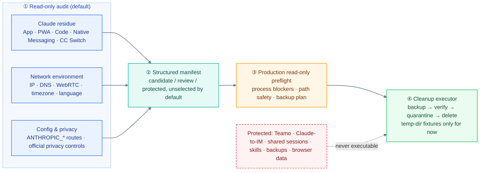

# Claude Env Cleanup Skill

[中文](README.md) | **English**

`claude-env-cleanup` is a Codex skill for auditing and cleaning local Claude / CC Switch / coding-agent residue on macOS.

Its default posture is: **audit first, mutate only when explicitly asked, back up before changes, and never print secret values.**

**Companion resources**

- Background and manual steps: [Claude stability checklist](https://blog.1pro.men/posts/claude-stability-checklist/) (Chinese): exit node, DNS, WebRTC, Claude Code, new-account pacing.
- Browser-side self-check: [1pro.men/whoami](https://1pro.men/whoami/) shows whether IP, DNS, WebRTC, timezone, language and fonts agree in the browser. The scripts here only see the local machine and command-line network; use the page for browser-visible signals.



## Use Cases

- Check whether Claude Code / Claude Desktop residue still exists
- Clean Claude App, Claude PWA, Claude Code URL Handler, and Chrome Native Messaging bridge residue
- Inspect `ANTHROPIC_*`, `127.0.0.1:15721`, CC Switch / 302AI / GLM route leftovers
- Remove CC Switch app, cask, and `~/.cc-switch` state
- Monitor Claude network environment: IP purity, DNS leaks, WebRTC leaks, and node-region stability
- Run a post-ban three-step self-check: clear browser cookies/site data, remove CC Switch, and inspect Claude Code plus Claude Desktop
- Generate a sanitized local environment baseline: timezone, language, exit region, DNS, ASN, WebRTC, and PWR fingerprint verdicts
- Enable official Claude Code privacy controls for telemetry, error reporting, feedback, surveys, and nonessential traffic
- Summarize early-account usage and fingerprint-reset takeaways
- Inspect browser fingerprint signals such as system timezone, `Intl` locale, browser language, and installed Chinese fonts
- Audit coding-agent config for route overrides, request rewriting, permission bypasses, and risky local gateway settings

## Install

Clone this repo into your Codex skills directory:

```bash
mkdir -p ~/.agents/skills
git clone https://github.com/pnedfff/claude-env-cleanup.git ~/.agents/skills/claude-env-cleanup
```

Restart Codex, then invoke the `claude-env-cleanup` skill when needed. Keep the whole `scripts/` directory: scripts load `scripts/audit_support.py` from their own directory.

## Read-Only Audit

Run the bundled audit script directly:

```bash
python3 ~/.agents/skills/claude-env-cleanup/scripts/audit_claude_env.py --audit
```

The script reports safe summaries only, such as file presence, key-name presence, route markers, process/port status, and browser bridge state. It does not print raw tokens, API keys, OAuth refresh tokens, or private config values.

The audit also checks whether official Claude privacy controls are enabled in the current process or in the `env` block of `~/.claude/settings*.json`.

For network environment auditing, run:

```bash
python3 ~/.agents/skills/claude-env-cleanup/scripts/audit_network_env.py
```

By default it only checks local proxy, DNS, route, and browser-language state. Add `--external` when you want live public-IP and Claude reachability probes. Manual review defaults to 3 core sites only: `ip.net.coffee/claude`, `ippure.com/claude`, and `iplark.com`.

For post-ban self-checks:

```bash
python3 ~/.agents/skills/claude-env-cleanup/scripts/audit_network_env.py --post-ban
```

This mode prints browser site-data cleanup targets, clear manual-action reminders, and the 5 guide sites: `ip.net.coffee/claude`, `iplark.com`, `net.coffee`, `ippure.com`, and `cc.mastersgo.cc`.

For a reusable local environment baseline, store the sanitized profile at:

```text
~/.claude/session-env/environment-fingerprint-profile.md
```

The profile should keep region, timezone, languages, local proxy ports, DNS summary, ASN/provider, WebRTC verdicts, and PWR fingerprint risk verdicts only. Do not store full public IPs, LAN IPs, gateways, tailnet addresses, exact WebRTC candidates, raw PWR detection payloads, cookies, tokens, or secrets.

### Output Status and Exit Codes

- `checked` means the check ran; `unknown` / `error` means collection was incomplete; `not_checked` means not requested or requires manual checking.
- Exit code `0` means collection completed for the requested scope, not that the environment is safe; `2` means collection was incomplete. External probes that were not requested are never reported as checked.
- History comparison reports match/difference only for country and ASN values present on both sides. Raw IPs are not stored, so the script never claims the IP is unchanged.
- New history records keep only sanitized country, ASN, timezone, aggregated languages, and listener counts. Proxy URLs show only scheme, host, and port.

## Official Privacy Controls

Claude Code's official data usage page documents environment variables for disabling telemetry, error reporting, feedback, session surveys, and nonessential traffic. The official settings page says environment variables can also be configured under the top-level `env` key in `settings.json`.

Recommended `~/.claude/settings.json` values:

```json
{
  "env": {
    "DISABLE_TELEMETRY": "1",
    "DISABLE_ERROR_REPORTING": "1",
    "CLAUDE_CODE_DISABLE_NONESSENTIAL_TRAFFIC": "1",
    "DISABLE_FEEDBACK_COMMAND": "1",
    "CLAUDE_CODE_DISABLE_FEEDBACK_SURVEY": "1",
    "DO_NOT_TRACK": "1"
  }
}
```

Notes:

- This is a privacy-control posture, not zero data retention or a full fingerprint reset.
- `CLAUDE_CODE_DISABLE_NONESSENTIAL_TRAFFIC` does not disable the WebFetch domain safety check.
- `skipWebFetchPreflight: true` is a separate WebFetch safety-check opt-out with security tradeoffs and should not be set automatically by default.
- Restart Claude Code, Claude Desktop, and related terminal sessions after changing these values.

References:

- [Claude Code data usage](https://code.claude.com/docs/en/data-usage)
- [Claude Code settings](https://code.claude.com/docs/en/settings)

Codex can automatically:

- Run read-only audits for timezone, language, proxy, system DNS, default route, local ports, and public-exit summaries.
- Back up and merge official privacy controls into the `env` block of `~/.claude/settings.json`.
- Create `~/.claude/session-env/`.
- Write a sanitized candidate profile.
- Re-read the file to check that it does not contain obvious full public IPs, LAN IPs, tailnet addresses, WebRTC candidates, cookies, or secrets.

The user must manually:

- Confirm the candidate before it is treated as a user-confirmed local baseline.
- Open `ip.net.coffee/claude`, `ippure.com/claude`, and `iplark.com` in the real browser for DNS/WebRTC/PWR/IP-risk verdicts.
- Restart the browser after timezone, language, proxy, extension, or cookie changes.
- Explicitly approve deletion of cookies, Local Storage, IndexedDB, extensions, browser profiles, Claude App, Claude Code, or CC Switch.

## Early-Account and Fingerprint-Reset Takeaways

These are operational stability heuristics, not a guarantee that account risk is eliminated:

- For the first two weeks, prefer the official Claude Desktop/App path and avoid standalone CLI use.
- During the early account phase, avoid third-party clients such as OpenCode, OpenClaw, and CraftAgent.
- Keep a human-like work/rest rhythm; avoid continuous 24-hour high-load use.
- IP type is not the only signal; avoid crowded public proxies and avoid frequent IP, country, or ASN switching early on.
- Do not share accounts.
- After a ban, fingerprint reset is the key step before using a new account: clear browser site data, extensions, Native Messaging, Claude App/Code residue, CC Switch, local auth/config/cache/log/telemetry residue, then re-check in the real browser.
- Treat the warm-up period as roughly one month or after the first renewal, then relax constraints gradually.

## Structured Cleanup Manifest

By default `audit_claude_env.py` only produces a metadata manifest of fixed Claude paths. It runs no processes, package managers, or network diagnostics and reads no config, credentials, or session content. The detailed audit requires `--audit`; cross-tool checks require `--scope all`.

```bash
python3 ~/.agents/skills/claude-env-cleanup/scripts/audit_claude_env.py                              # human-readable Claude manifest
python3 ~/.agents/skills/claude-env-cleanup/scripts/audit_claude_env.py --format json                # pure JSON on stdout
python3 ~/.agents/skills/claude-env-cleanup/scripts/audit_claude_env.py --scope all --format json    # cross-tool metadata review, still no cleanup
```

Each item has a stable ID, path, category, expected owner, detection status, candidate/review/protected verdict, impact, and protection reason, and is unselected by default. Ownership comes from fixed path rules, not verified install identity. Symlinked files or parents are not followed and are marked incomplete. `executable: false` / `review_only` mean review only; the manifest is not deletion authorization or a backup. `--audit` and `--format json` cannot be combined. Example: `examples/cleanup-manifest.fixture.json` (fixture data).

## Cleanup Executor (Temp-Dir Fixtures Only)

`scripts/cleanup_executor.py` provides `FixtureWorkspace.prepare(manifest, ids)` and `execute(plan)`. Workspaces are created only via an internal `TemporaryDirectory`; running the module directly refuses real cleanup. Only a fixed allowlist of cache/log candidates is supported.

1. Rebuild fixed targets from item IDs; reject duplicate/unknown IDs, protected and review-only items. Schema 1 manifests must be regenerated.
2. Prepare: re-verify identity metadata, snapshot identity and SHA-256 content, return a one-time review plan.
3. Execute: check the registered plan, parent identity, content snapshot, and complete process state; reject symlinks, hard links, special files, foreign ownership, unsafe paths, and over-limit scans; take an exclusive lock.
4. Back up every selected item and verify by digest, size, and directory structure before the first deletion.
5. Move originals atomically to quarantine, re-check, then delete. New files at the original path are never touched.
6. Stop on any error; the receipt records deleted, not run, failed, quarantined, or possibly partial items. No automatic rollback.

This is a test implementation, not an accepted production cleaner. Real-path write execution and restore remain closed. Example receipt: `examples/cleanup-execution.fixture.json`.

## Production Read-Only Preflight

`scripts/production_preflight.py` reads visible processes and fixed Claude candidate paths, then outputs a cleanup plan and backup proposal. It has no code path to create backups, edit config, stop processes, or delete data.

```bash
python3 ~/.agents/skills/claude-env-cleanup/scripts/production_preflight.py --format markdown
python3 ~/.agents/skills/claude-env-cleanup/scripts/production_preflight.py --format json
```

- `ps` reads only PID, PPID, UID, and executable/comm (no arguments); `lsof` checks file references; `launchctl print` checks Claude-to-IM. Raw output is never shown.
- Teamo, Claude-to-IM, and shared Claude state users are execution blockers only, never uninstall targets or auto-terminated.
- Scans stop at 10,000 entries or 10 seconds and report unknown. Plans are always `executable: false` with nothing selected.
- Backup is only proposed at `~/Backups/ClaudeCleanup/<plan-id>` (dirs 0700, files 0600); capacity precheck does not replace verified backup.
- A custom `CLAUDE_CONFIG_DIR` is reported as needing explicit scope and is not scanned automatically.
- Exit code 2 means blockers; 0 means no known blockers in the tested scope. Keep local reports out of the public repo.

## Tests

Fixture-only regression (does not audit the real environment):

```bash
PYTHONDONTWRITEBYTECODE=1 python3 -m unittest discover -s ~/.agents/skills/claude-env-cleanup/scripts -p 'test_*.py'
```

## Safety Boundaries

- Do not delete anything by default.
- Browser cookies, Local Storage, IndexedDB, extensions, and full browser profiles are not deleted automatically; they are high-impact actions and must be handled manually or with explicit authorization.
- Public repos should contain only generic workflow instructions, not a specific machine's full IP, LAN, tailnet, or WebRTC candidate data.
- Create a timestamped backup before editing or removing files, usually under `/Users/<you>/Backups/`.
- Preserve Teamo, `~/.teamo`, and `~/.claude/projects` by default.
- Preserve `com.claude-to-im.bridge` by default; it may be a Codex/IM bridge rather than official Claude residue.
- Do not delete macOS system fonts. PingFang, Hiragino, STHeiti, and Songti/STSong may remain detectable by canvas font probes.
- Do not conflate general proxies such as ClashX with Claude-specific routing on `127.0.0.1:15721`.

## Repository Layout

```text
.
├── SKILL.md
├── README.md / README.en.md
├── agents/openai.yaml
├── examples/                      # fixture manifest and execution receipt
└── scripts/
    ├── audit_claude_env.py        # Claude residue audit + manifest
    ├── audit_network_env.py       # network environment audit
    ├── audit_support.py           # shared helpers
    ├── cleanup_manifest.py        # structured manifest
    ├── cleanup_executor.py        # temp-dir fixture executor
    ├── production_preflight.py    # production read-only preflight
    └── test_*.py                  # fixture regression tests
```
